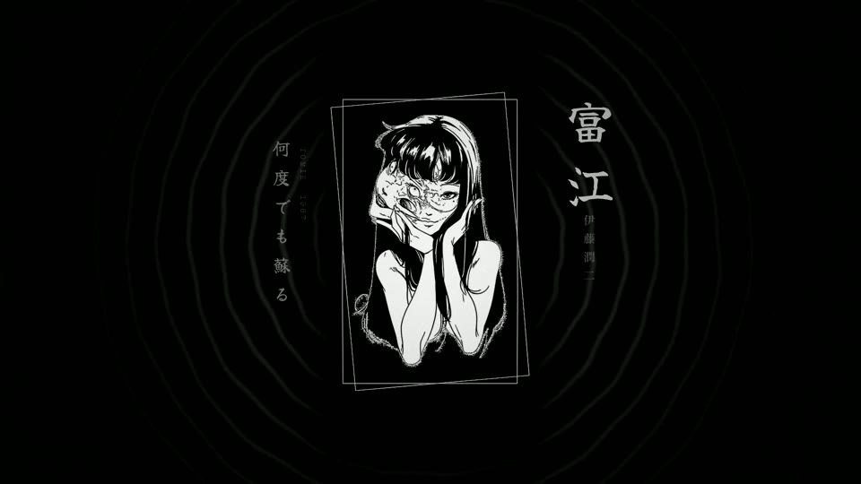
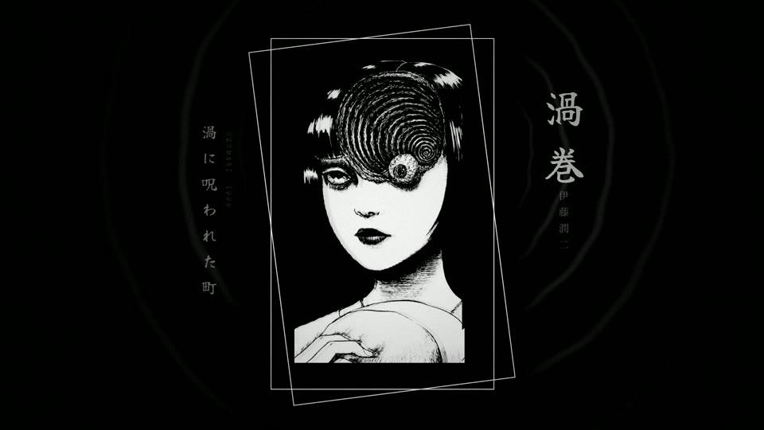
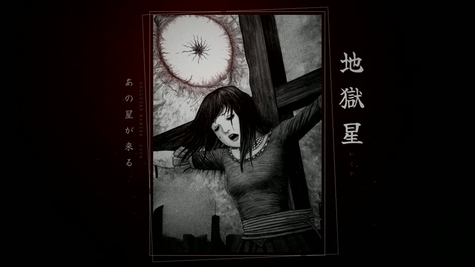
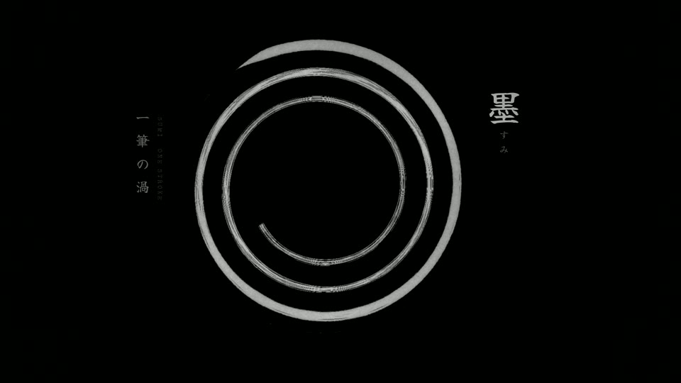
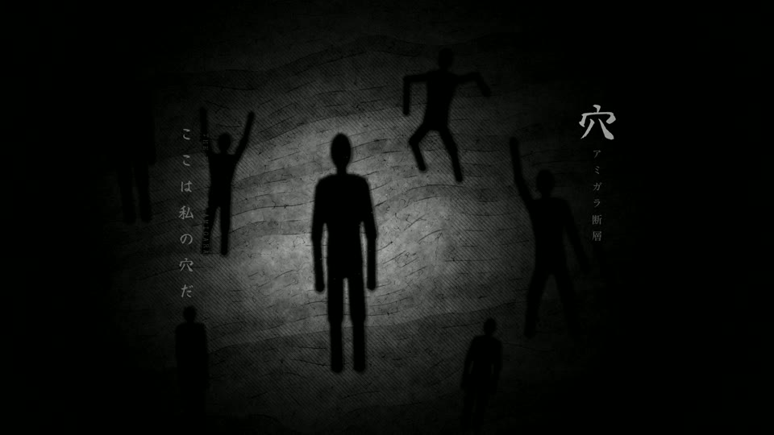

# ꩜ CatchyOs Rice: Junji Ito

My CachyOS + KDE Plasma 6 (Wayland) setup, themed after Junji Ito: ink black, manga-paper
white, grey, and one drop of dried blood. Every desktop is a living horror panel.

| | |
|---|---|
|  **1 富江 Tomie**: the fake face peels and its eyes roll |  **2 渦巻 Uzumaki**: her hair spiral sinks into itself forever |
|  **3 地獄星 Remina**: the Hellstar breathes and watches her |  **4 墨 Ink**: a brush writes a spiral, the wind takes it |
|  **5 穴 Amigara**: a torch searches the holes and finds yours | |

## Install on a new PC

On a fresh **CachyOS with KDE Plasma**, open Konsole and run:

```sh
# this repository is private: log in to GitHub once
sudo pacman -S --needed github-cli git
gh auth login

gh repo clone BrianFFranck/CatchyOs-Rice ~/CatchyOs-Rice
cd ~/CatchyOs-Rice
./install.sh
```

When it finishes, log out and back in. Reboot once to see the Uzumaki GRUB and boot screen.
`install.sh` asks for your password once. It is safe to run again: anything that failed (an AUR
build, for example) is retried and everything else is left as it is.

Only want your home folder themed (no packages, boot or login screen)? Run `./install.sh --no-system`.

## What you get

**Desktops and wallpapers**
* Five virtual desktops, each with its own 16 s animated loop. Switching **soaks the next one in through an ink bleed**: from the right going forward, from the left going back.
* **The spiral spreads**: inked spirals creep in from the screen edges the longer the PC stays on. They are fully grown after 6 h, and a reboot clears them.
* Everything pauses behind maximized or fullscreen windows and on low battery.

**Look**
* **Plasma Style**: popups, notifications and KRunner are black manga panels with screentone corners, and the loading spinner is a spiral.
* **Window frames**: a 1 px panel outline. Close is a spiral, maximize an open eye, minimize a closed eye.
* **Window animations**: windows open with a paper-white TV glitch and **close by winding into an inked spiral**.
* **Icons**: Papirus turned fully greyscale (~44k icons).
* **Fonts**: Zen Old Mincho, Shippori Mincho, Yuji Syuku brush and Special Elite typewriter.

**Sounds** (all synthesized)
* notifications: ink drips
* warnings: a creaking beam
* errors: knocks and a beating low tone
* low battery: a heartbeat
* login and logout: a temple bowl over a drone

**Panel and widgets**: a floating ink panel with the spiral launcher, **Ito Eye** (it watches your cursor), the Kara pager, **Ito Vitals** (CPU, temperature, RAM, network), the tray and a mincho clock. A vertical audio visualizer on both screen edges toggles with **Meta+Shift+V**.

**Boot and login**: GRUB with the Uzumaki art, a Plymouth spiral splash, and a themed login screen (if you use noctalia-greeter).

**Terminals**: Alacritty, Kitty, Konsole and Yakuake (F12) share one palette. There's a fish prompt, a spiral fastfetch, and `ito` prints a random line from the Ito universe.

**VS Code**: a "Junji Ito" colour theme and an Uzumaki ghost behind the code.

**Tiling**: Krohnkite. Polonium is installed but left off.

## Change or undo

| Task | Command |
|---|---|
| Undo the 5-desktop wallpapers, Plasma Style, sounds and spiral close | `./scripts/remove-haunted.sh` |
| Put the desktop back exactly as it was before the rice | `./scripts/restore.sh` (`--system` also reverts GRUB, Plymouth and the login screen) |
| Use your own video or picture on a desktop | Right-click desktop → Configure Desktop and Wallpaper → Desktop N |
| Preview the spiral spread | the same settings page → *Preview spread* |
| Re-render the wallpaper videos | `./scripts/build-desktops.sh` (~6 min) |

## Layout

```
install.sh          one-command installer
scripts/            install-system · install-user · install-haunted · restore · builders
assets/             finished videos and images (desktops/ = wallpapers 2–5)
themes/             colours, window frames, Plasma Style, wallpaper plugin, KWin effect,
                    sounds, widgets, GRUB, Plymouth, terminals, GTK, CopyQ
src/                how the Uzumaki spiral flow and the Remina clean-up were made
vscode/             VS Code theme and background patch
third-party/        Kara pager widget (GPL-3), bundled
docs/DETAILS.md     the long version: every file, every tweak, troubleshooting notes
```

## Notes

* Built for CachyOS (Arch) with KDE Plasma 6.8 on Wayland at 1920×1080. Other Arch-based distros with Plasma 6 should work. The wallpapers scale to other resolutions.
* After a KWin update, **KDE Rounded Corners** may need a rebuild: re-run `./install.sh`.
* Fonts are downloaded from Google Fonts (OFL / Apache 2.0) and icons are generated from Papirus (GPL-3) at install time.

## Credits

Artwork: **Junji Ito** (*Tomie*, *Uzumaki*, *Hellstar Remina*, *The Enigma of Amigara Fault*). The art
in `assets/` is his. This repo is a personal setup and isn't licensed for redistribution.
Window animations are built on [Burn My Windows](https://github.com/Schneegans/Burn-My-Windows)
(GPL-3). The icons are [Papirus](https://github.com/PapirusDevelopmentTeam/papirus-icon-theme), and the pager is
[Kara](https://github.com/dhruv8sh/kara).
